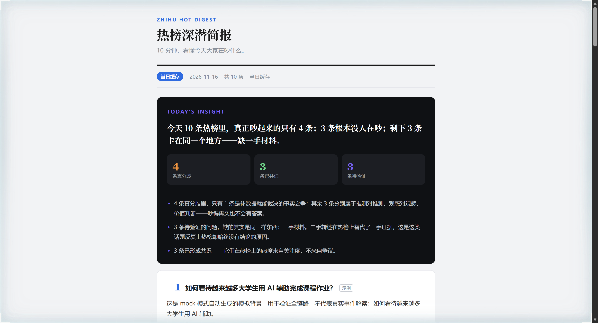
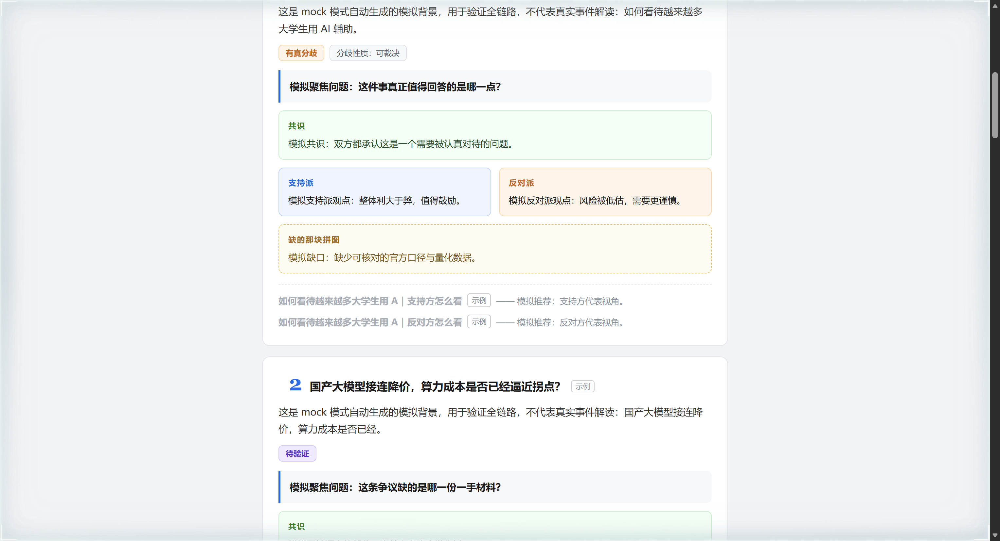

# 热榜深潜简报

> **10 分钟，看懂今天大家在吵什么。**

[](https://www.python.org/)
[](https://flask.palletsprojects.com/)
[](https://cloudbase.net/)

**[打开线上简报 →](https://zhihu-hot-digest-348140-5-1533039364.sh.run.tcloudbase.com/)** · [快速开始](#快速开始) · [测试与验收](#测试与验收)

知乎黑客松 S3 参赛作品。基于知乎开放平台 API，把当日 10 条热榜整理成一份可核查的争议简报：先给背景，再标出真分歧、已共识和待验证，最后说明还缺哪份一手材料。



## 不是摘要，是争议地图

热榜回答“今天什么最热”，这份简报继续回答“为什么值得深读”。每条热点按检索样本进入三种状态：

| 状态 | 什么时候出现 | 页面怎么呈现 |
|---|---|---|
| **真分歧** | 双方冲突真实存在 | 展开两种立场的双列对照，并标注分歧性质：可裁决、推测对推测、观感对观感或价值判断 |
| **已共识** | 热度来自关注度，而非观点对立 | 直接给样本内的共识，不制造假对立 |
| **待验证** | 缺少一手材料，暂时无法裁决 | 指出缺的是哪块拼图，不硬编两派观点 |

每条分歧还会生成一个**聚焦问题**，把热闹的争论收束成一个值得回答的问题。



延伸阅读只从当次知乎搜索 API 候选池映射，并经过域名校验和去重；内容可及性以知乎页面当前状态为准。

## 数据流与防幻觉架构

```text
GET /data.js
  ├─ 存在 data/brief_<今天>.json → 直接返回缓存（source=cache，秒开）
  ├─ 缓存过期（默认 3h TTL）→ 后台静默刷新，旧缓存继续服务，访客零等待
  │     └─ 刷新结果比旧缓存差（成功条数变少）→ 丢弃并进入冷却，守住全绿缓存
  ├─ 无缓存 → 立即返回静态兜底，同时在后台生成；页面低频轮询、成功后自动切换
  └─ 任一步异常 → data/fallback.json 静态兜底（source=fallback，页面仍完整）
```

### 缓存与恢复

- **冷缓存不阻塞**：真实模式把 1–3 分钟的整批构建放到后台，首访不再同步等待；`fallback.refreshing / retry_after` 只用于前端自动恢复，`source` 仍严格保持 `demo / live / cache / fallback` 四种取值。
- **失败重试冷却**：刷新异常、整批 0 条成功或劣化结果被丢弃后，默认冷却 15 分钟；旧缓存继续服务，避免访客流量反复触发整批生成。冷却只限制重试风暴，不替代日配额硬限额。
- **坏缓存自动恢复**：空 `items`、非对象条目、缺标题或损坏 JSON 均按缓存未命中处理；后台双重检查同时验证内容与 mtime，避免“新鲜坏缓存”阻止重新生成。

### 生成与链接约束

- **后端确定性组装**：知乎直答只输出结构化裁决字段（三态分类 / claim_type / 聚焦问题 / 缺口），最终的 `build_digest` 由后端代码确定性地执行，零模型自由度。
- **双重防幻觉**：大模型只输出候选编号，程序按编号映射回搜索 API 的真实返回；组装后再校验 URL 必须在本次搜索白名单内、主机名必须是 `zhihu.com` 或其子域名，越界与重复条目直接丢弃。上线首晚曾拦截过候选池之外的越界假编号。
- **完整性闸门**：声称 dispute 却凑不出两派真实观点的条目，自动降级为待验证——宁可承认缺材料，不编造对立。
- **文本安全收束与质量门**：字段超长时优先按完整句/分句收尾，无合适边界时显式省略；复核脚本检查乱码和疑似硬截断，冒烟脚本拦截降级哨兵，不把「字段非空」误报成内容验收通过。

### 质量与配额边界

- **单条降级**：每次大模型只处理 1 条热点，失败只降级该条，不中断整份简报；页面保留主标题与原问题入口，并明确说明素材不足时不编造背景与争议。
- **429 退避与配额边界**：知乎 API 限流时自动等待重试（默认 30s × 6 次）。零降级、不重试时，一轮生成消耗 1 次热榜 + 10 次搜索 + 10 次直答；3 小时 TTL 下理论最多约 8 轮/日，直答成功调用约 80–160 次/日，**不含 429 尝试**，且当前没有日配额计数或熔断。免费额度与价格以知乎控制台当期规则为准；真正限额需要另做配额守卫。

## 快速开始

只需 Python 3 和 Flask 一个依赖：

```bash
pip install flask
```

### 方式 A：mock 模式（无密钥 / 无网络，先跑通全链路）

```bash
# Windows PowerShell
$env:MOCK_MODE="1"; python app.py
# Windows CMD
set MOCK_MODE=1 && python app.py
# macOS / Linux
export MOCK_MODE=1 && python app.py
```

打开 `http://127.0.0.1:5000/`。**成功标志**：页面顶部徽章为「示例数据」，10 张卡片完整展示；终端打印「mock 模式：使用本地模拟数据」。

### 方式 B：真实数据（需要知乎开放平台 Access Secret）

```bash
$env:ZHIHU_ACCESS_SECRET="你的密钥"; python app.py   # PowerShell
```

**成功标志**：无缓存时页面先显示「演示兜底」，后端同时在后台生成，页面会自动轮询并在缓存落盘后切换为「当日缓存」；不再让首访请求同步等待 1–3 分钟。之后 3 小时缓存期内秒开。顶部同时显示真实生成时刻，格式为「数据截至：YYYY-MM-DD HH:mm｜当日缓存｜共 10 条」；读取缓存不会再用状态文字覆盖 `generated_at`。进程不可达仍不属于数据层兜底的覆盖范围。

### 本地双击预览

直接双击 `demo/index.html`：读取同目录静态 `data.js`，无需启动后端。

## 部署

线上实例部署于腾讯云 CloudBase 容器型云托管（Docker），`Min 1 / Max 1` 常驻单实例 + 原子文件写入，可降低缓存分裂与半截文件风险；但容器内缓存不是持久化历史仓库，部署或实例重建仍可能丢旧快照。任何能运行 Python 的托管均可（Render / Railway / PythonAnywhere 等），通用步骤：

1. 上传代码（不要上传 `.env` 与 `data/brief_*.json`）。
2. 平台环境变量里填入 `ZHIHU_ACCESS_SECRET`（平台会自动提供 `PORT`）。
3. 启动命令 `python app.py`。
4. **必须验证**：用手机流量打开公网链接，确认评委视角可完整访问。

**CloudBase 部署命令（固定用仓库根目录，不要再建 `deploy/` 副本）**：

```bash
tcb cloudrun deploy \
  --env-id genuine-dove-d8gywlbm2e6dbc1b8 \
  --service-name zhihu-hot-digest \
  --source . --port 5000 --force --wait
```

- 根目录 `.dockerignore` 已将构建上下文限定为 `app.py / demo / data / requirements.txt`，其余文件（文档、视频、宣发素材）不会进镜像；
- 历史上曾用 `deploy/` 子目录副本部署，出现过"改了根目录却推了旧代码"，该目录已于 2026-11-17 删除，**不要重建**；
- CLI 有交互提示「是否灰度发布」，非交互环境需 `printf '\n' | tcb ...` 送默认回车，`--force` 不覆盖此项。

## 测试与验收

**本项目没有接入 CI**，所有检查均为本地脚本手动执行。

十二项 Python 测试是**独立脚本，不是 unittest 用例**（没有 `TestCase` 类），因此 `python -m unittest discover` 会显示 0 项——这是预期行为，不是"测试不存在"。正确运行方式：

```bash
python tests/test_cache_timestamp.py  # 缓存保留真实生成时刻，旧缓存按 mtime 补齐
python tests/test_cache_ttl.py        # 缓存 TTL 到点后台刷新
python tests/test_refresh_guard.py    # 后台刷新结果劣于旧缓存时丢弃
python tests/test_retry_pass.py       # 整批结束后对降级条目补跑一轮
python tests/test_text_quality.py     # 安全收束、乱码/疑似硬截断与降级冒烟拦截
python tests/test_cold_start.py       # 冷缓存立即兜底、并发只生成一次、全败不落坏缓存
python tests/test_refresh_cooldown.py # 异常与劣化刷新后的重试冷却
python tests/test_invalid_cache.py    # 空/非对象/损坏 JSON 缓存均能自动恢复
python tests/test_verification_scripts.py # 验收脚本有界等待、兜底不误判版本
python tests/test_reading_index_guard.py # 延伸阅读编号守卫：bool/非整数编号不得选中候选
python tests/test_quota_guard.py      # 按接口按日计数、失败/429 计入、达上限熔断跳过
python tests/test_web_evidence.py     # 全网证据核验试点：单条、四态、补跑去重、配额 0 跳过
```

前端行为另有两项 Node 测试（仅开发验收需要 Node.js，线上运行时不增加依赖）：

```bash
node tests/test_frontend_recovery.js  # 异常轮询、空缓存、首次恢复、健康缓存不循环刷新
node tests/test_paged_navigation.js   # 分页导航与目录行为
```

其余验收脚本：

```bash
python scripts/smoke_check.py                                   # 单次严格 HTTP 冒烟，默认单请求 15s 超时
python scripts/smoke_check.py --wait 360 --timeout 15           # 部署后有界等待冷缓存恢复，再跑完整内容门
python scripts/verify_live.py                                   # v2 结构验收；fallback 明确判为内容未就绪
python scripts/verify_plan_numbers_v2.py data/baseline_insight_v2.json   # 复现计划书附录 A 固定基线
python scripts/verify_plan_numbers_v2.py data.js                         # 复核当日线上快照
python scripts/audit_gap_quality.py                                      # gap 可执行性预筛（启发式，需人工复核）
```

> `data/baseline_insight_v2.json` 是人工归类预览基线，**不是运行时产物**，不能用它跑 `smoke_check.py`。
> 评审期运维（冷缓存自动恢复、配额触顶、预热、回滚）见 `值班卡_评审期运维_2026-11-17.md`；本轮二次修复与部署边界见 `HANDOFF_稳定性二次修复_2026-11-18.md`。

## 研发工具链

- **Kimi Code**：正式用于代码阅读、功能开发、调试、测试与差异审查；提交、推送、部署仍须负责人确认。
- **Kimi Claw**：云端「柳东凯」的两个首页只读巡检条目已启用，分别在每天 09:17、21:23（Asia/Shanghai）仅 GET 生产根路径；本机旧条目已于 2026-11-19 21:28 删除。21:23 自动触发、日志与异常告警已验证，结果为 HTTP 503；这表示巡检机制正常、被巡检首页不可用，不代表简报内容验收通过。Claw 不进入核心生成链路，不持有密钥，不自动修改仓库或生产环境。
- **Kimi Work**：继续承担本地文件处理与综合交付。

具体权限、实际任务编号、运行记录和退出条件见 `研发工具链_Kimi_Code_Claw.md` 与 `HANDOFF.md`。这些工具属于研发与运营辅助，不改变 Demo 架构，也不作为产品核心创新宣称；首页巡检不能替代 10 条内容完整性与质量验收。

## 目录结构

```
.
├── app.py               # Flask 后端：调 API、三态裁决、缓存与兜底
├── demo/
│   ├── index.html       # 页面（本地双击可预览静态示例）
│   └── data.js          # 静态示例数据（部署后由后端接管同名路由）
├── data/
│   ├── fallback.json    # 静态兜底数据（任何异常下保证页面可完整展示）
│   └── brief_*.json     # 当日缓存（运行时自动生成，勿提交）
├── docs/images/         # README 截图
├── Dockerfile           # CloudBase 云托管镜像
├── .env.example         # 环境变量模板（不含真实密钥）
└── README.md
```

## 环境变量

见 `.env.example`。除 `ZHIHU_ACCESS_SECRET` 外都有默认值。

- `ZHIHU_ACCESS_SECRET`：知乎开放平台密钥，**等同密码**，只通过环境变量读取，绝不写进代码 / 仓库。
- `MOCK_MODE=1`：mock 模式开关。
- `ZHIDA_MODEL`：知乎直答模型，默认 `zhida-fast-1p5`。
- `MODEL_API_KEY` / `MODEL_BASE` / `MODEL_NAME`：备选通用大模型（OpenAI 兼容接口），三项齐全后知乎直答失败时自动切换。
- `PORT`：服务端口，默认 5000。
- `CACHE_TTL_HOURS`：当日缓存有效期（小时），默认 3，过期后由访问流量惰性触发后台静默刷新；设为 `0` 恢复「每日只生成一次」。
- `REFRESH_COOLDOWN_SECONDS`：刷新异常、整批 0 条成功或劣化结果丢弃后的冷却时间，默认 900 秒；冷却期间保留旧缓存或静态兜底，不重复调用上游。
- `RETRY_WAIT` / `RETRY_TIMES`：429 限流退避的等待秒数与总尝试次数，默认 30 / 6。

## 分步验证命令

```bash
# 1) mock 模式全链路
MOCK_MODE=1 python app.py
curl http://127.0.0.1:5000/data.js   # 成功：首行 window.BRIEF_DATA = {"date":...，含 digest 三态统计
curl http://127.0.0.1:5000/data.js   # 第二次：source 变为 "cache"
ls data/                             # 出现 brief_YYYY-MM-DD.json

# 2) 兜底路径（mock 关掉、密钥乱填、指向不可达地址）
MOCK_MODE=0 ZHIHU_ACCESS_SECRET=fake ZHIHU_BASE=http://127.0.0.1:9 python app.py
curl http://127.0.0.1:5000/data.js   # 成功：source 为 "fallback"，页面仍完整

# 3) 缺密钥（mock 关掉、不设密钥）
MOCK_MODE=0 python app.py            # 成功：打印中文设置指引，退出码 1，无 traceback
```

## 报错对照表

| 现象 | 含义 | 处理 |
|---|---|---|
| 启动提示缺少 `ZHIHU_ACCESS_SECRET` | 未设置密钥且未开 mock | 按提示设置环境变量，或先 `MOCK_MODE=1` |
| 知乎接口错误码 `20001` | 鉴权失败 | 检查密钥是否正确、是否带 Bearer |
| 知乎接口错误码 `30001` | 频率限制或额度用尽 | 退避重试自动处理；当日缓存天然限流 |
| 页面徽章「演示兜底」 | 生成链路任一环节失败 | 属预期兜底行为，看终端日志定位原因 |
| 某卡片显示「本条暂无可用素材，未生成解读」 | 该条单点生成降级 | 保留主标题与原问题入口，不影响其余卡片；冒烟脚本会将该快照判为 FAIL，提交前须复查 |
| 首次刷新后内容没变化 | 缓存未过期 | 正常；TTL 默认 3 小时，后台静默刷新 |

## 演进路线

**V1（当前）：当日横切面**——每天 10 条热榜的三态裁决快照。

**V2（规划）：时间轴深潜**——对同一事件追踪 72 小时内知乎叙事的演化：观点何时反转、哪些早期少数派被验证、评论区是怎么吵起来的。当前每日缓存具备快照形态，但历史持久化尚未实现；迁移到对象存储并建立事件索引，是 V2 上线的第一项工程。

## 参考与引用披露

- **AI 辅助开发**：本作品由学生团队完成，开发过程全程使用 AI 辅助编程（结对 AI + 人工验收）。
- **数据来源**：知乎开放平台 API（热榜、站内搜索）与知乎直答；所有延伸阅读链接均来自知乎搜索 API 的真实返回并跳回知乎站内。
- **开源组件**：Flask（BSD-3-Clause），通过 `pip install flask` 引入，未修改其源码。
- **设计打磨**：页面视觉参考开源 Skill [heydamir/unslop](https://github.com/heydamir/unslop)（作者 Damir Sokolovsky，[CC BY 4.0](https://creativecommons.org/licenses/by/4.0/)）进行九层审查，未执行其第三方脚本。
- **README 文案**：参考 [MohamedAbdallah-14/unslop](https://github.com/MohamedAbdallah-14/unslop)（MIT）的自然语言清理原则；保留命令、路径、数字与技术事实，未使用 AI 检测规避功能。
