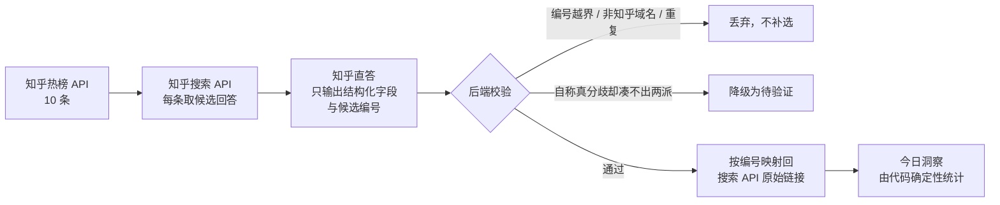

# 热榜深潜简报

> **10 分钟，看懂今天大家在吵什么。**

[](https://github.com/youcare7/zhihu-hot-digest/actions/workflows/test.yml)
[](https://www.python.org/)
[](https://flask.palletsprojects.com/)
[](https://cloudbase.net/)

**[打开线上简报 →](https://zhihu-hot-digest-348140-5-1533039364.sh.run.tcloudbase.com/)** · [一条热榜会变成什么](#一条热榜会变成什么) · [怎么防幻觉](#怎么防幻觉) · [快速开始](#快速开始)

知乎黑客松 S3 参赛作品。热榜告诉你今天什么最热，这份简报告诉你它为什么值得深读：基于知乎开放平台 API，把当日 10 条热榜逐条判成**真分歧、已共识、待验证**三种状态，给出背景和聚焦问题，并写明还缺哪一份一手材料。


## 一条热榜会变成什么

以 2026-11-21 的一条热榜为例（来自[功能示例页](https://zhihu-hot-digest-348140-5-1533039364.sh.run.tcloudbase.com/showcase/)使用的人工整理快照 `data/showcase.json`，字段结构与程序生成的一致）：

> **胖东来搬离后原址所开新商场几乎倒闭，怪涨租还是怪经营？**
>
> **状态**：真分歧 · 推测对推测（双方都在推测原因，谁都没有公开证据）
>
> **聚焦问题**：一门生意的价值到底写在地段和物业里，还是写在品牌与客流的信任里？
>
> | 品牌信任派 | 市场定价派 |
> |---|---|
> | 客流跟着品牌走，不跟着地段走；人一搬走商圈就凉了，稀缺的是信任，不是物业。 | 租金涨到 2400 万仍可能回本，是正常市场定价；接手方失败是招商与管理问题。 |
>
> **双方都不否认**：胖东来在时把冷清街区带成了商圈；一街之隔的新店至今依旧红火。
>
> **还缺的拼图**：接手商场历年营收、招商与租金口径的一手披露；“年利润六七千万”等说法只出自当事人讲述视频，未见原始凭证。

同一天另外两种状态长这样：

| 状态 | 什么时候出现 | 例子 | 页面给什么 |
|---|---|---|---|
| **真分歧** | 双方冲突真实存在 | 上面的胖东来 | 两派对照，并标出分歧性质：可裁决 / 推测对推测 / 观感对观感 / 价值判断 |
| **已共识** | 热度来自关注，而非观点对立 | 秦岭驴友遇难案：站内公认法院责任划分准确 | 直接给共识，不制造假对立 |
| **待验证** | 缺一手材料，暂时裁决不了 | 顺丰被暂停全军采购：违规事项与期限官方均未披露 | 指出缺哪块拼图、去哪找，不硬编两派 |


## 怎么防幻觉



- **模型不写链接**：模型只返回候选编号，程序按编号映射回搜索 API 的真实返回，再校验链接在本次候选池内、主机名是 `zhihu.com` 或其子域名。上线首晚就拦下过候选池之外的越界编号。
- **两派都要有原回答作证**：每一派必须指向至少 1 条站内回答（同样只给编号、由程序映射成知乎链接），同一条回答不能同时支撑对立的两派。读者点「原回答」就能核对这一派是否真的存在；给不出两派成型观点、或任一派找不到对应回答的条目，自动降级为“待验证”。
- **拦截过程公开**：每次生成时，各道校验丢弃了多少越界编号、站外链接，有几条真分歧因凑不出两派或找不到原回答而降级，都由代码计数，显示在页面「来源与链接」页；两派下方附所引回答的原文摘录（只截断、不改写），可以和模型的概括直接对照。
- **统计不交给模型**：首页“今日洞察”的计数和措辞全部由后端代码根据三态结果计算，模型没有自由发挥的空间。
- **失败只影响一条**：每次只让模型处理一条热点，某条失败只降级该条，页面保留标题与原问题入口，其余照常展示。
- **人工整理内容单独存放**：首页和静态兜底只用程序生成的数据，原问题与延伸阅读链接全部来自知乎站内。早期人工整理的跨平台核验快照放在单独的[功能示例页](https://zhihu-hot-digest-348140-5-1533039364.sh.run.tcloudbase.com/showcase/)（`/showcase/`），页面标明“功能示例”，站外链接逐条标“站外”。
- **跨平台核验也走编号映射**：开启 `QUOTA_WEB_SEARCH_DAILY` 后，程序用知乎全网搜索取信源，模型只能按编号引用，链接由程序映射回搜索结果原文；配额默认 0，即关闭。

## 稳定性

```text
GET /data.js
  ├─ 有当日缓存        → 直接返回（秒开）
  ├─ 缓存过期（默认 3h）→ 照常返回旧缓存，后台静默刷新
  │     └─ 新结果比旧的差 → 丢弃，冷却 15 分钟，继续用旧缓存
  ├─ 还没有缓存        → 立即返回静态兜底（最近一天程序生成的快照），后台生成，页面自动切换
  └─ 任一步异常        → data/fallback.json，页面仍然完整
```

刷新时按知乎问题 ID 复用当日已生成的条目，只为新上榜的热点调用直答；所有接口调用都有按日配额熔断，429 走有界指数退避。细节与参数见 [docs/ops.md](docs/ops.md)。

## 快速开始

需要 Python 3.11 与 Flask：

```bash
pip install -r requirements.txt
```

**没有密钥也能跑**（mock 模式，不联网，页面徽章显示“示例数据”）：

```bash
MOCK_MODE=1 python app.py          # macOS / Linux
$env:MOCK_MODE="1"; python app.py  # Windows PowerShell
```

打开 `http://127.0.0.1:5000/`，能看到完整的 10 张卡片即为成功。

**真实数据**需要知乎开放平台 Access Secret：

```bash
export ZHIHU_ACCESS_SECRET="你的密钥" && python app.py
```

首访会先显示静态兜底，后台生成完成后页面自动切换为“当日缓存”。也可以不启动后端，直接双击 `demo/index.html` 预览静态示例。

部署、环境变量和报错对照见 [docs/ops.md](docs/ops.md)。

## 测试

每次 push 由 GitHub Actions 自动运行 Python 测试、前端测试和镜像启动冒烟，全程不读取密钥、不联网。本地一次跑完：

```bash
for f in tests/test_*.py; do python "$f" || echo "FAIL $f"; done
npm run test:frontend
```

每个测试覆盖什么、验收脚本怎么用，见 [docs/testing.md](docs/testing.md)。

## 演进路线

- **V1（当前）当日横切面**：每天 10 条热榜的三态裁决快照。
- **V2（进行中）时间轴深潜**：GitHub Actions 每天归档当日简报到 `data/archive/`，“合订本”页把同一事件的多日快照串成时间线，观察观点何时反转、哪些早期少数派被验证。

## 文档

| 文档 | 内容 |
|---|---|
| [docs/产品说明计划书_v2.7修订版.md](docs/产品说明计划书_v2.7修订版.md) | 产品说明计划书 |
| [docs/答辩问答手册.md](docs/答辩问答手册.md) | 评委可能的追问与回答 |
| [docs/ops.md](docs/ops.md) | 部署、环境变量、缓存与配额、报错对照 |
| [docs/testing.md](docs/testing.md) | 测试清单与验收脚本 |
| [docs/topic_timeline_architecture.md](docs/topic_timeline_architecture.md) | 合订本（时间线）架构 |
| [docs/handoff/](docs/handoff/) · [docs/archive/](docs/archive/) | 开发交接记录与历史存档 |

## 参考与引用披露

- **AI 辅助开发**：本作品由学生团队完成，开发过程全程使用 AI 辅助编程（结对 AI + 人工验收），工具链说明见 [docs/ops.md](docs/ops.md#研发工具链)。
- **数据来源**：知乎开放平台 API（热榜、站内搜索）与知乎直答；延伸阅读链接以知乎搜索 API 真实返回的站内链接为主，仅在“待验证”条目启用 `web_evidence` 时附带少量经校验的外部来源。
- **开源组件**：Flask（BSD-3-Clause）、gunicorn（MIT），通过 pip 引入，未修改源码。
- **设计打磨**：页面视觉参考开源 Skill [heydamir/unslop](https://github.com/heydamir/unslop)（作者 Damir Sokolovsky，[CC BY 4.0](https://creativecommons.org/licenses/by/4.0/)）进行九层审查，未执行其第三方脚本。
- **README 文案**：参考 [MohamedAbdallah-14/unslop](https://github.com/MohamedAbdallah-14/unslop)（MIT）的自然语言清理原则；保留命令、路径、数字与技术事实，未使用 AI 检测规避功能。
